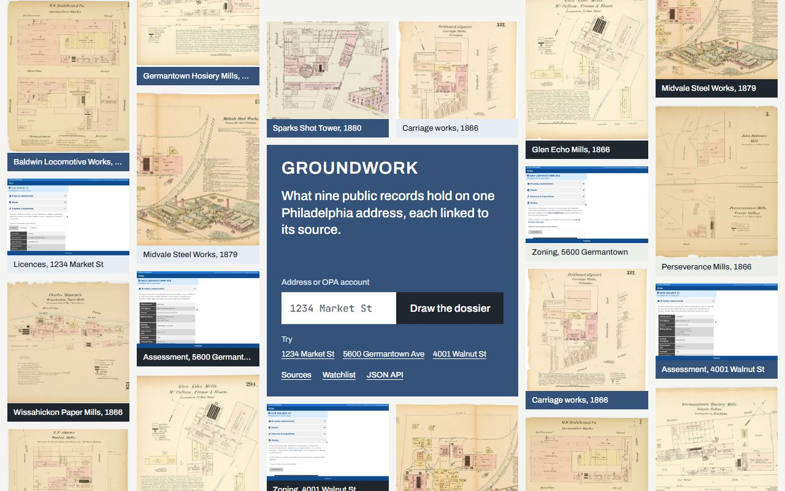

# Groundwork

Groundwork builds a Philadelphia property dossier from public sources. It returns JSON and a readable report with source links, evidence and gaps. Watches can record changes in assessment and licensing pages.

Live URL: **https://groundwork.hamdanesmail12-7a9.workers.dev**

## Sources

These are the nine entries exposed by `/api/sources`; last successful read times are available there. Nine sources from seven public bodies: five city departments, the school district and FEMA.

| Section | Source | Method | Monitorable |
|---|---|---|---|
| Assessment and sale | Office of Property Assessment | Fetch | Yes |
| Zoning | Department of Planning and Development | Fetch | No |
| Licences and inspections | Department of Licenses & Inspections | Fetch | Yes |
| Deeds and parcel | Department of Records | Fetch | No |
| Assessment history | Office of Property Assessment | Agent | No |
| Real estate tax | Department of Revenue | Agent | No |
| Flood zone | FEMA | Agent | No |
| Catchment schools | School District of Philadelphia | Agent | No |
| Permit and violation history | Department of Licenses & Inspections | Agent | No |

## How TinyFish is used

| Product | Use |
|---|---|
| Fetch | Read the four Atlas sections and resolve addresses. |
| Agent | Read assessment history, tax, flood, schools and the deeper L&I history. |
| Browser | Capture screenshots of the free Atlas sections. |
| Monitor | Watch the Atlas licensing and assessment pages for changes. |

## How the paid sheets run

Each of the five Agent sheets runs in its own Cloudflare Workflow instance. On the Workers free plan one invocation may make 50 requests to other hosts, and one sheet (a start, a poll every 10 seconds, two reads at the end) fits inside that; five in one instance did not, which is what the first live reports showed me. Only one run is in flight at a time across the whole site: an instance that finds the slot taken sleeps 20 seconds and asks again, so waiting costs no requests. A run that was paid for and not read is read again, never bought twice. `POST /api/dossiers/:id/retry` (admin token) reads again the sheets that ended in error.

What a run costs, from the 20 so far: valuations 3 to 4 steps, schools 3 to 10, the permit history 9 to 15, the tax balance 15, the FEMA search 6 (capped, because it has never found anything). A step is $0.016, so a full report is $0.60 to $0.90 on top of the free sheets.

## API

The same table is on the site's About page.

| Route | What it does |
|---|---|
| `POST /api/dossiers` | Starts a dossier from `{"address": "1234 Market St"}` or `{"opa_account": "883309050"}`. 202 with its id and report link. An address the city cannot place answers 200 with `status: "failed"` and how to resolve it; a condominium building answers with its units to choose from. A unit goes in the address (`3600 Market St Unit 700`) or beside it as `"unit": "700"`. |
| `GET /api/dossiers/:id` | One dossier, every sheet with its source link. `gaps` names the sheets asked for and not read; each carries `reason` and `reason_text`. |
| `POST /api/dossiers/:id/upgrade` | Reads the four remaining sheets of a free dossier. Once a day from one place. |
| `POST /api/dossiers/:id/retry` | Admin: reads again the sheets that ended in error, or only those named in `{"sections": [...]}`. |
| `POST /api/dossiers/:id/deepen` | Admin: adds the permit and violation history. |
| `POST /api/dossiers/:id/watch` | Starts two Monitors on the address (licences, assessment). |
| `GET /api/sources`, `/api/stats`, `/api/events`, `/api/export.json` | The nine sources, the counts and spend, recorded changes, the curated set. |

A refused call answers `{"error": "..."}` with the matching HTTP status (`not_found`, `rate_limited`, `invalid_input`, `atlas_unavailable`, `budget_paused`).

## Demo reports

Three addresses read in full on 10 November 2026, each with two watches on it. Every one has gaps, and says so on its page and in `gaps` in its JSON.

| Address | Report | What was read | What was not, and why | Cost |
|---|---|---|---|---|
| 1234 Market St | [report](https://groundwork.hamdanesmail12-7a9.workers.dev/d/58ab6fd2-f093-454e-afa4-ef9acae13952) | The four city sheets, 13 years of valuations, 3 catchment schools | Tax (the tax site turned the browser away), flood (FEMA), permit history (155 permits and 83 violations counted, no rows returned) | $1.00 |
| 5600 Germantown Ave | [report](https://groundwork.hamdanesmail12-7a9.workers.dev/d/5f080574-7846-4a5b-bded-0cf67553b2e3) | The four city sheets, 13 years of valuations, a tax balance of $0.00, 7 permits and 10 of 66 violations by row; the school finder found no catchment school | Flood (FEMA) | $0.87 |
| 4001 Walnut St | [report](https://groundwork.hamdanesmail12-7a9.workers.dev/d/bf3e3130-530c-4891-998f-2b283f2ffb63) | The four city sheets, 13 years of valuations, 3 catchment schools, 10 of 22 permits and 10 of 47 violations by row | Tax (turned away), flood (FEMA) | $0.87 |

The four city sheets come from TinyFish Fetch and cost nothing but a screenshot each. The other five are browser reads, and a browser read of a city site does not always work: of the 15 such sheets in these three reports, 8 were read, 1 found nothing to list and 6 are gaps (it took 20 runs to get there). A sheet that was not read says why and links the page to check by hand.

## Run locally

Use Node 24 or newer and `npm ci`. Copy `.dev.vars.example` to `.dev.vars` and set the three values locally. Run `npm run migrate:local` and `npm run dev`. `npm run check` checks types, runs offline tests and performs a deployment dry run. See [the runbook](docs/runbook.md) for deployment and live tests.

## Limits and posture

Groundwork supports individual address lookups, not bulk collection. Public requests start at the free tier and have daily limits; watches and paid calls have caps. FEMA may return no result or be unavailable; check the linked FEMA source directly. Public records may contain information about people: use and share results with care. Demo properties were selected for organization ownership.
